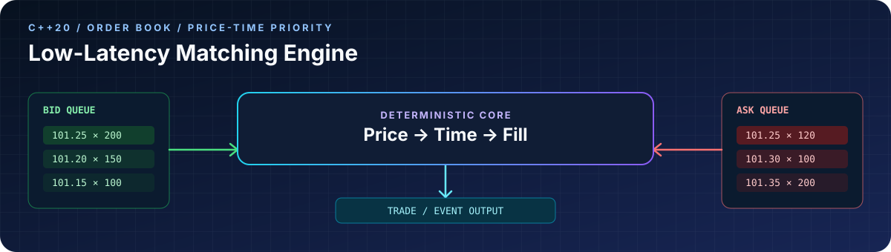

# Vankudothu Adhi Naik

Backend systems, C++ data structures, and practical data workflows.

Integrated M.Tech student in Mathematics and Computing at IIT (ISM) Dhanbad.

[GitHub](https://github.com/vankudothuadhinaik) / [Email](mailto:22je1052@iitism.ac.in)

## Engineering focus

I build small, testable systems with explicit state, clear interfaces, and reproducible evaluation. My current work sits at the intersection of systems programming, backend engineering, data processing, and applied machine learning.

- Systems programming: C++20, order books, price-time priority, bounded queues.
- Backend engineering: Java, Spring Boot, Python, FastAPI, REST APIs, SQLAlchemy.
- Data workflows: validation, normalization, deduplication, and deterministic aggregation.
- Quality: unit tests, frontend tests, Maven, CMake, and GitHub Actions.

## Selected work

### Low-Latency Matching Engine

[Repository](https://github.com/vankudothuadhinaik/low-latency-matching-engine)

An educational C++20 limit-order book with price-time priority, full and partial fills, cancellation, fixed-point prices, order lookup, and a bounded SPSC event path.

`C++20` `CMake` `order book` `unit tests`

Educational implementation; benchmark results are environment-dependent.

### UPI Offline Mesh

[Repository](https://github.com/vankudothuadhinaik/UPI_Without_Internet)

A Spring Boot settlement prototype covering encrypted QR payloads, RSA-PSS signatures, replay and idempotency defenses, simulated store-and-forward delivery, and atomic settlement.

`Java 17` `Spring Boot` `AES-GCM` `RSA-PSS`

Native device networking and bank or NPCI settlement rails are outside the current implementation.

### DataPulse Analytics

[Repository](https://github.com/vankudothuadhinaik/DataPulse-Analytics)

A full-stack event analytics prototype with FastAPI ingestion and aggregation, SQLAlchemy models, a React and TypeScript dashboard, backend tests, and a configured Vite production build.

`FastAPI` `SQLAlchemy` `React` `TypeScript`

Prototype scope excludes authentication and deployment integration.

## Open-source contributions

### CPython — free-threaded garbage collection

[**Merged PR #160707**](https://github.com/python/cpython/pull/160707) · [Issue #160682](https://github.com/python/cpython/issues/160682) · C · Runtime · Regression testing

Fixed missing references to running function objects in free-threaded garbage-collector traversal paths and added a regression test. The PR was merged into CPython `main` on October 26, 2026.

Validation reported for a Py_DEBUG free-threaded build: focused regression passed; the free-threaded GC module had 8 passing tests; the `test_free_threading` package had 267 passed and 1 skipped. Native macOS validation was not performed.

### CPython — interrupted kqueue waits

[**Open PR #160714**](https://github.com/python/cpython/pull/160714) · [Issue #160700](https://github.com/python/cpython/issues/160700) · Python · Subprocess · Signal handling

Proposed fix to propagate `InterruptedError` from `kqueue.control()` while retaining fallback polling for other `OSError` failures, with a kqueue-specific regression test. The PR is open and still requires suitable CI/macOS validation; the focused test has not been run locally.

### chunklet-py — Windows multiprocessing fix

[**Merged PR #107**](https://github.com/speedyk-005/chunklet-py/pull/107) · Python · Multiprocessing · Pytest

Fixed a Windows multiprocessing pickling issue by replacing a local wrapper closure with a module-level callable. Added pickle round-trip regression coverage and a native Windows multiprocessing test for the public API. The PR was merged upstream after six CI checks passed.

## Additional projects

- [HealthStream ETL](https://github.com/vankudothuadhinaik/HealthStream-ETL) — Standard-library Python ETL for synthetic healthcare encounter events, with validation, normalization, deduplication, deterministic summaries, and quality reporting.
- [AQI Prediction](https://github.com/vankudothuadhinaik/Predicting-the-AQI-of-Indian-Cities-Using-Machine-Learning) — Time-series experiments with a dependency-free chronological persistence baseline evaluated independently per station series.
- [TodoList Management Application](https://github.com/vankudothuadhinaik/TodoList-Management-Application) — Browser-only React task workflow with accessible add, complete, and delete actions plus localStorage persistence.

## Working principles

Prefer understandable systems over impressive claims; test important boundaries and document how results were produced. I distinguish merged contributions from open proposals and report validation limitations explicitly.

## Contact

[GitHub](https://github.com/vankudothuadhinaik) / [22je1052@iitism.ac.in](mailto:22je1052@iitism.ac.in)
